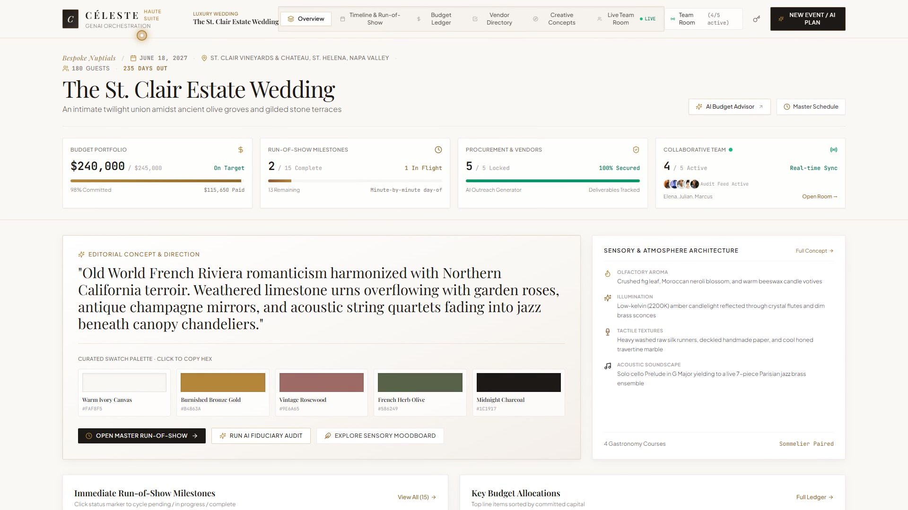

# Céleste — GenAI Event Orchestration & Collaboration Suite

[](https://ai.google.dev/)
[](https://react.dev/)
[](https://www.typescriptlang.org/)
[](LICENSE)

Céleste is an editorial luxury event planning assistant designed to curate, organize, and orchestrate weddings, milestone birthdays, and community galas. It combines **Gemini 3.8 Flash** intelligence for automated budget calculations, run-of-show timelines, vendor checklists, and personalized aesthetic concepts with an interactive multi-user collaborative workspace.

---

## 📹 Product Walkthrough & Demo Video

Watch the official 1080p high-definition walkthrough of Céleste, featuring studio voiceover narration and ambient background score:

[](demo/celeste_luxury_suite_demo.mp4)

- **Interactive Showcase Player**: [`demo/index.html`](demo/index.html) *(features one-click chapter jumping, responsive playback, and download)*
- **Direct Video File**: [`demo/celeste_luxury_suite_demo.mp4`](demo/celeste_luxury_suite_demo.mp4) (1080p Full HD, 2:17 duration)
- **Live Suite URL**: [https://manaditi.github.io/Celeste-Luxury-Event-Planning-Suite/](https://manaditi.github.io/Celeste-Luxury-Event-Planning-Suite/)

### Walkthrough Chapters
- `0:01` — **Executive Overview & Hero Architecture**: Napa Valley St. Clair Estate, budget metrics ($240k committed), and sensory atmosphere architecture.
- `0:16` — **Timeline & Precision Run-of-Show**: Second-by-second master schedules, load-in timing, and champagne preludes.
- `0:38` — **Budget Ledger & AI Fiduciary Advisor**: Line-item allocations, paid deposits, and Gemini 3.8 Flash autonomous risk modeling ($1,333/guest) and vendor levers.
- `1:04` — **Secured Vendor Directory**: Premier ateliers, Michelin-grade catering, Lumière cinema suites, and contract audits.
- `1:26` — **Creative Concepts & Dynamic Palettes**: Interactive swatch switching (*Burnished Bronze Gold*, *Vintage Rosewood*, *French Herb Olive*).
- `1:44` — **Live Multi-User Team Room**: Real-time collaborative presence and live audit logs.
- `1:56` — **GenAI Instant Plan Generation**: Launching the Gemini planner, selecting the *Lake Como Villa Wedding* preset, and transforming the suite into *Villa Balbiano Renaissance Nuptials*.
- `2:11` — **Outro & Call to Action**: Final aesthetic pan and showcase conclusion.

---

## Key Features

1. **Editorial Luxury Visual Aesthetic**:
   - **Canvas & Palette**: Warm ivory canvas (`#FAF8F5`), champagne undertones (`#F4EFEA`), deep charcoal typography (`#1C1917`), and warm burnished gold/bronze metallic hairline accents (`#B4863A` / `#946A29`).
   - **Zero-Pill Discipline**: Metadata (dates, currencies, deadlines, attendee counts) formatted with clean unboxed text and subtle typographic separators (`·` or `/`). Interactive filters use clean segmented tabs rather than candy-colored badges.
   - **Typography & Numerals**: Serif display typography (*Playfair Display*), readable geometric modern sans (*Plus Jakarta Sans*), and tabular monospace numerals (`tabular-nums font-mono`) for monetary amounts and timestamps to prevent visual jitter.

2. **3-Zone Top Bar & 4-Stat Metric Strip**:
   - **Zone 1 (Brand & Portfolio)**: Monogram mark, brand title, and quick portfolio switcher dropdown with benchmark presets.
   - **Zone 2 (Navigation Segmented Tabs)**: Overview, Timeline & Run-of-Show, Budget Ledger, Vendor Directory, Creative Concepts, Live Team Room.
   - **Zone 3 (Actions & Status)**: Real-time team room status pill, API key configuration, and primary GenAI creation CTA.
   - **4-Stat Metric Strip**: Real-time Budget progression with variance, Run-of-Show completion counter, Secured Vendor procurement ratio, and Active Team Room presence.

3. **Multi-View Workspace**:
   - **Overview Dashboard**: Aesthetic vision narrative, copyable color swatches, next run-of-show milestones, top budget allocations, secured vendor directory snapshot, and live audit feed.
   - **Run-of-Show Timeline**: Dual-view schedule (*Planning Milestones* months out vs. *Day-of Master Schedule* minute-by-minute), filterable by team role (*Lead Director, Floral & Decor, A/V & Sound, Hospitality & Bar, Host & VIP*), inline interactive status cycle (*Pending → In Progress → Completed → Delayed*), print/export schedule.
   - **Interactive Budget Ledger**: Category breakdowns (*Venue, Catering, Floral, Photo, Sound, Transport, Stationery, Contingency*), planned vs. committed vs. paid tracking with automated variance calculations, in-line payment status advancement, per-guest cost metrics, and AI Budget Advisor tool.
   - **Vendor Directory & AI Outreach**: Vendor tracking with contract milestones and task deliverable checklists. One-click Gemini inquiry/negotiation outreach email generator with tone customization (*Editorial Luxury, Polite Inquiry, Firm Contract Negotiation*).
   - **Creative Concepts & Moodboards**: Color palette swatches with Pantone references, 4-pillar sensory motifs (*Olfactory Aroma, Illumination, Tactile Textures, Auditory Soundscape*), 4-course gastronomy and wine pairings, and interactive Gemini creative brainstormer.
   - **Live Team Room**: Real-time presence indicators with active cursor/card viewing tags (*Elena Vance, Julian Ross, Marcus Croft, Siobhan Roy, Victoria Chen*), live simulated activity engine with configurable speed (*Realistic / 20s vs. Fast / 7s*), manual simulation triggers, and directorate chat dispatch.

4. **Server-Side GenAI Proxy**:
   - Node / Express server (`server.ts`) hosting secure endpoints using `@google/genai` with model `gemini-3.8-flash`:
     - `POST /api/events/generate-plan`: Structured JSON event plan generation.
     - `POST /api/events/vendor-inquiry`: Tailored vendor outreach and contract email drafts.
     - `POST /api/events/creative-ideas`: Curated moodboard, color palettes, and sensory motifs.
     - `POST /api/events/budget-advisor`: Financial analysis, health index, variance risk alerts, and cost optimization trade-offs.
   - Full offline fallback synthesis ensures 100% operational reliability and high-density luxury response formatting at all times.

---

## Quick Start

### Installation & Run
```bash
npm install
npm run dev
```

The app will launch:
- **Client Frontend**: `http://localhost:5173/`
- **Express GenAI Proxy**: `http://localhost:3001/`
