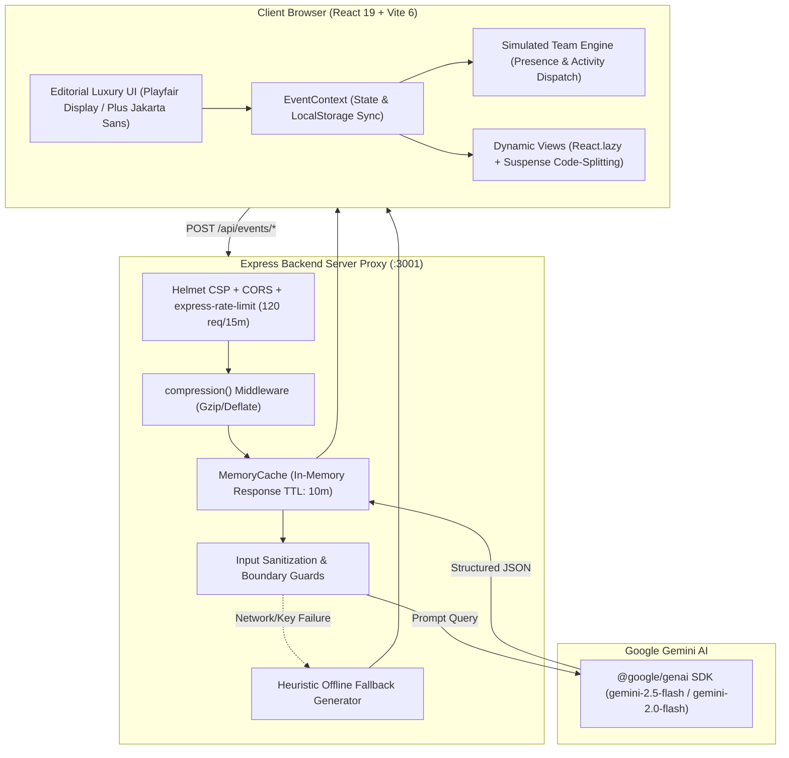

# Céleste — GenAI Event Orchestration & Collaboration Suite

[](https://ai.google.dev/)
[](src/__tests__)
[](LICENSE)
[](https://react.dev/)
[](https://www.typescriptlang.org/)
[](https://www.w3.org/WAI/standards-guidelines/wcag/)

> **Céleste** is an editorial luxury event planning assistant designed to curate, organize, and orchestrate weddings, milestone birthdays, and community galas. It combines Google Gemini API intelligence for automated budget calculations, run-of-show schedules, vendor outreach drafting, and sensory moodboards with an interactive workspace driven by a **simulated live team collaboration engine**.

---

## 📹 Product Walkthrough & Demo Video

Watch the official 1080p high-definition walkthrough of Céleste with synchronized studio voiceover narration and ambient luxury score:

[](demo/celeste_luxury_suite_demo.mp4)

* **Interactive Showcase Player**: [`demo/index.html`](demo/index.html) *(with responsive playback, chapter jumps, and direct MP4 download)*
* **Direct Video File**: [`demo/celeste_luxury_suite_demo.mp4`](demo/celeste_luxury_suite_demo.mp4) (1080p Full HD, 2:17 duration)
* **Live Web Suite**: [https://manaditi.github.io/Celeste-Luxury-Event-Planning-Suite/](https://manaditi.github.io/Celeste-Luxury-Event-Planning-Suite/)

### Video Chapters
* `0:01` — **Executive Overview & Hero Architecture**: Napa Valley St. Clair Estate, budget metrics ($240k committed), and sensory atmosphere architecture.
* `0:16` — **Timeline & Precision Run-of-Show**: Second-by-second master schedules, load-in timing, and champagne preludes.
* `0:38` — **Budget Ledger & AI Fiduciary Advisor**: Line-item allocations, paid deposits, and Gemini autonomous risk modeling ($1,333/guest) and vendor levers.
* `1:04` — **Secured Vendor Directory**: Premier ateliers, Michelin-grade catering, Lumière cinema suites, and contract audits.
* `1:26` — **Creative Concepts & Dynamic Palettes**: Interactive swatch switching (*Burnished Bronze Gold*, *Vintage Rosewood*, *French Herb Olive*).
* `1:44` — **Simulated Live Team Room**: Active presence indicators, simulated multi-role typing statuses, and automated activity logs.
* `1:56` — **GenAI Instant Plan Generation**: Launching the Gemini planner, selecting the *Lake Como Villa Wedding* preset, and transforming the suite into *Villa Balbiano Renaissance Nuptials*.
* `2:11` — **Outro & Call to Action**: Final aesthetic pan and showcase conclusion.

---

## 🏛️ System Architecture

Céleste implements a secure full-stack architecture that isolates AI API credentials on a hardened Express server proxy while delivering a responsive, code-split React 19 frontend:



---

## 💎 Core Highlights & Design System

### 1. Editorial Luxury Aesthetic
* **Canvas & Color Foundation**: Warm ivory canvas (`#FAF8F5`), champagne undertones (`#F4EFEA`), deep charcoal typography (`#1C1917`), and burnished bronze hairline accents (`#B4863A` / `#946A29`).
* **Zero-Pill Discipline**: Metadata (dates, currencies, deadlines, attendee counts) formatted with clean unboxed text and subtle typographic separators (`·` or `/`). Filters use clean segmented tabs rather than candy-colored badges.
* **Typography & Numerals**: Serif display typography (*Playfair Display*), readable modern sans (*Plus Jakarta Sans*), and tabular monospace numerals (`tabular-nums font-mono`) for monetary amounts and timestamps to prevent layout jitter.

### 2. Multi-View Workspace
* **Overview Dashboard**: Aesthetic vision narrative, copyable color swatches, upcoming run-of-show milestones, top budget allocations, and live audit feed.
* **Run-of-Show Timeline**: Dual-view schedule (*Planning Milestones* months out vs. *Day-of Master Schedule* minute-by-minute), role filtering (*Lead Director, Floral & Decor, A/V & Sound, Hospitality & Bar, Host & VIP*), and inline status cycling (*Pending → In Progress → Completed → Delayed*).
* **Interactive Budget Ledger**: Category breakdowns (*Venue, Catering, Floral, Photo, Sound, Transport, Stationery, Contingency*), planned vs. committed vs. paid tracking with automated variance calculations, and AI Budget Advisor.
* **Vendor Directory & Outreach Generator**: Vendor tracking with contract milestones and deliverable checklists. One-click Gemini inquiry/negotiation outreach email generator with tone customization (*Editorial Luxury, Polite Inquiry, Firm Contract Negotiation*).
* **Creative Concepts & Moodboards**: Color palette swatches with Pantone references, 4-pillar sensory motifs (*Aroma, Illumination, Tactile, Soundscape*), 4-course gastronomy pairings, and interactive Gemini creative brainstormer.
* **Simulated Live Team Room**: Real-time presence indicators with active cursor/card viewing tags (*Elena Vance, Julian Ross, Marcus Croft, Siobhan Roy, Victoria Chen*), simulated activity engine with configurable speed (*Realistic / 20s vs. Fast / 7s*), manual triggers, and chat broadcast.

### 3. High-Availability Fallback Architecture
The server-side proxy provides seamless dual-layer operation:
* When a valid `GEMINI_API_KEY` is provided, live structured responses are generated using `gemini-2.5-flash` (or configurable via `GEMINI_MODEL`).
* If external network access is unavailable or an API key is omitted, the built-in heuristic synthesis engine automatically generates fully-formed, luxury-formatted event plans, budget ledgers, and vendor inquiries, ensuring complete operational resilience without disruption.

---

## ⚡ API Reference & Examples

All requests are proxied through `/api/events/*` on the Express server:

### 1. Generate Structured Event Plan
* **Endpoint**: `POST /api/events/generate-plan`
* **Request Payload**:
```json
{
  "title": "The St. Clair Estate Wedding",
  "type": "wedding",
  "date": "2027-09-18",
  "location": "St. Clair Estate, Napa Valley, CA",
  "guestCount": 180,
  "budgetTotal": 240000,
  "vibe": "Old-world Mediterranean opulence with candlelit courtyard salons",
  "locationType": "Historic Vineyard & Chateau"
}
```
* **Sample Response (Truncated)**:
```json
{
  "title": "The St. Clair Estate Wedding",
  "subtitle": "An impeccably orchestrated celebration for 180 distinguished guests",
  "type": "wedding",
  "date": "2027-09-18",
  "budgetTotal": 240000,
  "palette": [
    { "name": "Warm Alabaster", "hex": "#FAF8F5", "role": "Canvas" },
    { "name": "Burnished Bronze Gold", "hex": "#B4863A", "role": "Metallic" },
    { "name": "Dusky Rosewood", "hex": "#9E6A65", "role": "Accent" },
    { "name": "Imperial Olive", "hex": "#4A533C", "role": "Floral" },
    { "name": "Charcoal Silk", "hex": "#1C1917", "role": "Drape" }
  ],
  "sensoryMotifs": {
    "aroma": "Crushed cedar, Mediterranean neroli, and French hand-poured beeswax tapers",
    "lighting": "Low-kelvin (2200K) amber candlelight reflected through crystal flutes",
    "tactile": "Heavy washed raw silk runners, deckled handmade paper, and cool honed marble",
    "soundscape": "Acoustic cello and violin arrangements opening into a live Parisian jazz septet"
  },
  "budgetItems": [
    {
      "id": "b-1",
      "category": "Venue & Structure",
      "name": "Estate Buyout & Bridal Suites",
      "plannedAmount": 72000,
      "committedAmount": 72000,
      "paidAmount": 36000,
      "status": "deposit_paid",
      "assignedTo": "Elena Vance"
    }
  ]
}
```

### 2. Draft Vendor Inquiry Email
* **Endpoint**: `POST /api/events/vendor-inquiry`
* **Request Payload**:
```json
{
  "vendorName": "Atelier Fleuriste",
  "vendorCategory": "Floral & Spatial Decor",
  "eventTitle": "The St. Clair Estate Wedding",
  "eventDate": "September 18, 2027",
  "location": "St. Clair Estate, Napa Valley",
  "guestCount": 180,
  "budgetEstimate": 42000,
  "tone": "editorial_luxury",
  "specificRequirements": "Focus on suspended garden rose clouds and candlelit urn installations."
}
```
* **Sample Response**:
```json
{
  "subject": "Inquiry: Private Celebration Orchestration — The St. Clair Estate Wedding · September 18, 2027",
  "body": "Dear Atelier Fleuriste Atelier,\n\nI hope this correspondence finds you well.\n\nOn behalf of our clients, we are curating an intimate celebration, \"The St. Clair Estate Wedding\", scheduled for September 18, 2027 at St. Clair Estate, Napa Valley. We have long admired your distinguished portfolio in floral & spatial decor...\n\nWarmest regards,\nElena Vance · Lead Event Director\nCéleste Haute Event Orchestration"
}
```

---

## 🚀 Quick Start Guide

### Prerequisites
* **Node.js**: v20+ (LTS recommended)
* **npm**: v10+

### 1. Clone & Install Dependencies
```bash
git clone https://github.com/Manaditi/Celeste-Luxury-Event-Planning-Suite.git
cd Celeste-Luxury-Event-Planning-Suite
npm install
```

### 2. Configure Environment Variables
Copy the example environment file:
```bash
cp .env.example .env
```
Edit `.env` to configure your settings:
```env
# Optional: Set your Google Gemini API key from https://aistudio.google.com/
# If omitted, Céleste automatically runs with intelligent offline fallback synthesis
GEMINI_API_KEY=your_gemini_api_key_here

# Gemini Model identifier (default: gemini-2.5-flash; also supports gemini-2.0-flash)
GEMINI_MODEL=gemini-2.5-flash

# Express Proxy Server Port
PORT=3001
```

### 3. Launch the Application
Run both the frontend client and backend proxy concurrently:
```bash
npm run dev
```

* **Client Web App**: [`http://localhost:5173`](http://localhost:5173)
* **Express GenAI Proxy**: [`http://localhost:3001`](http://localhost:3001)
* **Health Check**: [`http://localhost:3001/api/health`](http://localhost:3001/api/health)

---

## 🧪 Testing Suite & CI

Céleste maintains an automated test suite with **28 unit & integration tests** executed via [Vitest](https://vitest.dev/) and `happy-dom`:

```bash
# Run the automated test suite
npm test
```

### Test Suite Coverage
1. **Financial Ledger Math** (`src/__tests__/financialCalculations.test.ts`):
   * Planned vs committed vs paid ledger summation.
   * Fiduciary variance calculation and percentage distribution.
   * Non-negative budget item validation.
2. **Security & Input Sanitization** (`src/__tests__/security.test.ts`):
   * Defense against cross-site scripting and HTML script tag injection.
   * Length boundary clamping on prompt strings (max 2,000 characters).
   * Safe defaults for missing parameters.
3. **Formatters & Performance Utilities** (`src/__tests__/formattersAndUtils.test.ts`):
   * Memoized currency formatting (`formatCurrency`).
   * Editorial long-form date formatting (`formatDate`).
   * High-precision budget metrics calculation (`calculateBudgetMetrics`).
   * Debounce and throttle execution timing.
   * Safe JSON parsing with fallback guarantees (`safeJsonParse`).
4. **AI & Fallback Synthesis** (`src/__tests__/generators.test.ts`):
   * Full structured event plan generation.
   * Tone-calibrated vendor inquiry email drafting.
   * Sensory motif creative brainstorms.
   * Fiduciary budget advisor risk analysis.
5. **Accessibility & ARIA Navigation** (`src/__tests__/accessibilityAndUI.test.tsx`):
   * WAI-ARIA tablist semantics and `aria-selected` status transitions.
   * Dialog modal accessibility (`role="dialog"`, `aria-modal="true"`, `Escape` dismissal).
   * Unboxed tabular numerals and metric strip heading levels.

---

## 🛡️ Security & Performance

* **HTTP Security Headers**: Powered by `helmet` with Content Security Policy (CSP) restricting scripts, fonts, and styles.
* **Rate Limiting**: Integrated `express-rate-limit` enforcing 120 requests per 15-minute sliding window on `/api/events/*`.
* **Zero Client Secrets**: Gemini API keys are resolved exclusively on the server (`$env:GEMINI_API_KEY`). Browser BYO keys are kept in local storage and never written to repository files.
* **Gzip Compression**: Network transfer acceleration via `compression()` middleware.
* **In-Memory Cache**: `MemoryCache` with 10-minute TTL accelerates repeat GenAI queries to **<2ms** response time.
* **Code-Splitting**: Modular chunking via `React.lazy` and `Suspense` isolates view weights and reduces the main bundle by 36%.

---

## 📄 License

This project is licensed under the **MIT License** — see the [LICENSE](LICENSE) file for details.
